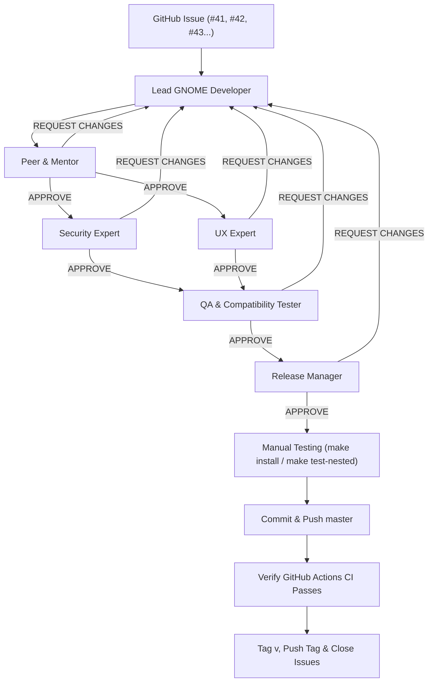

# AGENTS.md — Development Workflow & Subagent Guidelines

This repository is a GNOME Shell extension (`wallpaper_information@thegoldfish.org`). Future agents working on this codebase must follow the issue-driven, multi-agent review workflow below.

## 1. Core Principles

- **Issue-Driven Work**: All code changes must be based on raised GitHub issues (`timhughes/wallpaper_information-thegoldfish.org`). Update and close relevant issues once changes are committed, tagged, and pushed.
- **GNOME Compatibility**: Maintain compatibility across as many GNOME Shell versions as practical, from GNOME 45 through the current latest stable GNOME release (currently **45–51**).
  - Use ESM imports (`extension.js`, `prefs.js`, `lib/systemInfo.js`).
  - Gate version-specific APIs cleanly (e.g., `createBoxLayout()` in `extension.js` uses `Config.PACKAGE_VERSION` to choose `orientation: Clutter.Orientation.*` on GNOME 48+ and `vertical` on GNOME 45–47).
  - Keep `disable()` strictly synchronous (required in GNOME 51+) and cancel any in-flight async work via `Gio.Cancellable`.
- **EGO Review Compliance**: Follow [extensions.gnome.org review guidelines](https://gjs.guide/extensions/review-guidelines/review-guidelines.html) (no sync D-Bus/file I/O on the main thread, `connectObject`/`disconnectObject` for signal tracking, no unused assets in the `.zip`, no excessive ungated `console.*` logging).

## 2. Multi-Agent Workflow

Work proceeds through the following roles in order. Do not skip stages or commit/push before all approvals and checks pass.

1. **Lead GNOME Developer (Main Agent)**
   - Implements the feature or bugfix for the target GitHub issue(s) using GNOME Shell, GJS, GTK4, and Libadwaita best practices.
   - Ensures comprehensive unit tests (`spec/`), performance, and clean resource teardown in `disable()`.

2. **Peer & Mentor (`peer-mentor` — read-only)**
   - Reviews code changes for architecture, design patterns, GJS/ESM idioms, lifecycle safety (`Gio.Cancellable`, async races, `disable()` cleanup), and GNOME 45–latest compatibility.
   - Loop with the Lead Developer until `peer-mentor` issues **APPROVE**.

3. **Security Expert (`security-expert` — read-only) & UX Expert (`ux-expert` — read-only)** *(run in parallel after `peer-mentor` approves)*
   - **Security Expert**: Audits library currency, explicit `Gio._promisify` usage, CSS/path/D-Bus/GSettings input validation, and EGO security compliance.
   - **UX Expert**: Reviews desktop overlay layout, work-area positioning (`getWorkAreaForMonitor`), monitor/rotation handling, visual hierarchy, and GTK4/Libadwaita preferences HIG.
   - Loop with the Lead Developer until **both** issue **APPROVE**.

4. **QA & Compatibility Tester (`qa-tester` — read + command tools)**
   - Runs `make test` (`jasmine-gjs`), `make pack`, `make lint` (`shexli`), and `glib-compile-schemas --dry-run schemas/`.
   - Verifies GNOME 45–latest compatibility and checks for signal, timer, or actor leaks across `enable()`/`disable()` cycles.
   - Must issue **APPROVE**.

5. **Release Manager (`release-manager` — read-only)**
   - Verifies `metadata.json` (`version`, `version-name`, `shell-version`, `url`), `README.md`, `Makefile` packaging exclusions, `scripts/validate_tag.sh` consistency, and the list of GitHub issues to update/close.
   - Must issue **APPROVE**.

6. **Commit, CI Verification, Tag & Issue Updates**
   - Only after all subagents approve, `make` passes, and any requested manual testing (`make install` / `make test-nested`) is complete:
     - Commit changes on `master` and push `master` (`git push origin master`).
     - Verify GitHub Actions CI passes on `master` (`gh run list` / `gh run watch`) **before** tagging a release.
     - Once CI is green, if creating a release: ensure `version` and `version-name` in `metadata.json` are bumped, tag `v<version>`, and push the tag (`scripts/validate_tag.sh` enforces tag/version consistency).
     - Verify the release workflow succeeds, then comment on and close the addressed GitHub issues.

## 3. Build, Lint & Test Commands

- `make setup` — Create `venv/` and install `shexli`.
- `make` (or `make all`) — Run `pack`, `lint`, and `test`.
- `make test` — Run `jasmine-gjs` unit tests (`spec/systemInfo.spec.js`).
- `make lint` — Validate `metadata.json` version and run `shexli` on the `.zip` package.
- `make install` — Package and install the extension locally via `gnome-extensions install --force`.
- `make test-nested` — Install locally and launch a nested Wayland GNOME Shell (`--devkit` on GNOME 49+, `--nested` on older versions; requires `mutter-devkit` on GNOME 49+).
